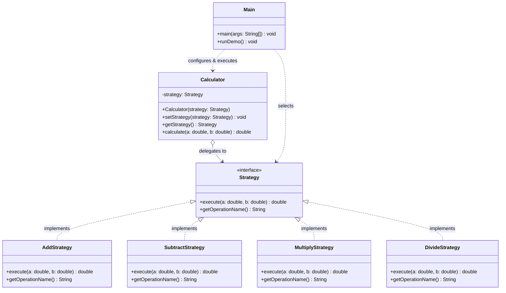

# Assignment #5: Strategy Pattern Report
- **Student:** Alibi Maksut (Group SE-2523)
- **Topic:** Option B — Calculator

---

## 1. Introduction

For this assignment, the **Calculator** domain (Option B) was implemented. In computational systems, performing arithmetic operations using a chain of conditional statements (`if-else` or `switch`) tightly couples the dispatcher to every specific mathematical operation. Whenever an operator is added or updated, the dispatcher must be reopened, violating the Open/Closed Principle.

The **Strategy Pattern** eliminates conditional logic by encapsulating each arithmetic operation behind a uniform interface (`Strategy`). The execution is delegated to concrete interchangeable algorithms (`AddStrategy`, `SubtractStrategy`, `MultiplyStrategy`, `DivideStrategy`) managed by an algorithm-agnostic context (`Calculator`).

---

## 2. UML Class Diagram



---

## 3. Clean Code Requirements

Five Clean Code principles (Martin, 2008) applied in this implementation:

### 3.1. Elimination of Conditional/Branching Logic in Favor of Polymorphism
- **Before (Procedural Conditional Chain):**
```java
public double calculate(String op, double a, double b) {
    if ("+".equals(op)) return a + b;
    else if ("-".equals(op)) return a - b;
    else if ("*".equals(op)) return a * b;
    else if ("/".equals(op)) return a / b;
    throw new UnsupportedOperationException();
}
```
- **After (Polymorphic Delegation in `Calculator.java`):**
```java
public double calculate(double a, double b) {
    return strategy.execute(a, b);
}
```

### 3.2. Meaningful, Intention-Revealing Names
- Classes (`AddStrategy`, `SubtractStrategy`, `MultiplyStrategy`, `DivideStrategy`), interface (`Strategy`), context (`Calculator`), and execution methods (`calculate`, `execute`) clearly state their purpose without requiring inline comments.

### 3.3. Single Responsibility Principle (SRP)
- Each strategy class encapsulates exclusively one arithmetic rule. `Calculator` is solely responsible for holding the current strategy reference and delegating execution.

### 3.4. Context Remains Algorithm-Agnostic
- `Calculator` has no knowledge of addition, subtraction, division-by-zero checks, or math operators. It depends strictly on the `Strategy` interface abstraction.

### 3.5. Easy Extensibility Demonstrated (Open/Closed Principle)
- `DivideStrategy` was added as an independent class implementing `Strategy`. Neither `Calculator` nor existing strategy classes were modified (demonstrated in `extension.diff`).

---

## 4. Strategy vs. State

1. **Coupling and Independence:** In the **Strategy pattern**, algorithms are completely independent and interchangeable. Strategies do not know about each other and do not trigger transitions between operations. In the **State pattern**, concrete states typically know about sibling states and initiate transitions on the context (e.g., Draft -> Published).
2. **Configuration Authority:** In the **Strategy pattern**, the client decides which operation to execute and configures the Context externally. In the **State pattern**, transitions occur internally in response to context actions.
3. **Domain Fitness:** Arithmetic operations are independent algorithms selected by the user. Addition does not "transition" into multiplication as part of an internal lifecycle. Therefore, the calculator requires the **Strategy pattern**.

---

## 5. Conclusion

### Flexibility Gained vs. Classes Added
- **Classes Added:** Decomposing a procedural calculator into separate strategy classes increases class count.
- **Flexibility Gained:**
  1. Runtime interchangeability without conditional branching.
  2. Isolated unit testability for each mathematical formula.
  3. Adherence to Open/Closed Principle: new operations (e.g. `PowerStrategy`, `ModulusStrategy`) are added without modifying existing code.

---

## 6. Verification and Demonstration Outcomes

```text
T1 PASS | Calculator + AddStrategy | 10 + 5 = 15.0
T2 PASS | Calculator + SubtractStrategy | 10 - 5 = 5.0
T3 PASS | Calculator + MultiplyStrategy | 10 * 5 = 50.0
T4 PASS | Runtime Strategy Switch on Same Context Instance | sameInstance=true | Add(24.0) -> Multiply(80.0)
T5 PASS | Calculator + DivideStrategy (Extension) | 10 / 5 = 2.0
T6 PASS | Invariant Defense | Null Strategy Rejection verified
T7 PASS | Input Validation | Division by zero rejected safely
SUMMARY: 7/7 PASS
```

---

## 7. Link to GitHub Repository

- **GitHub Repository URL:** [https://github.com/M1ska2021/Assignment5_Strategy](https://github.com/M1ska2021/Assignment5_Strategy)
